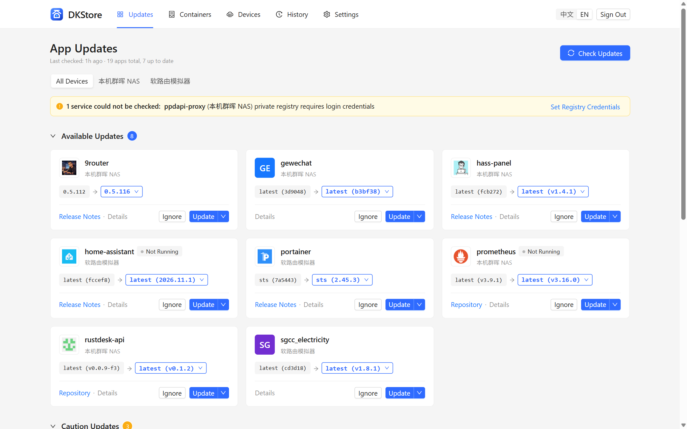
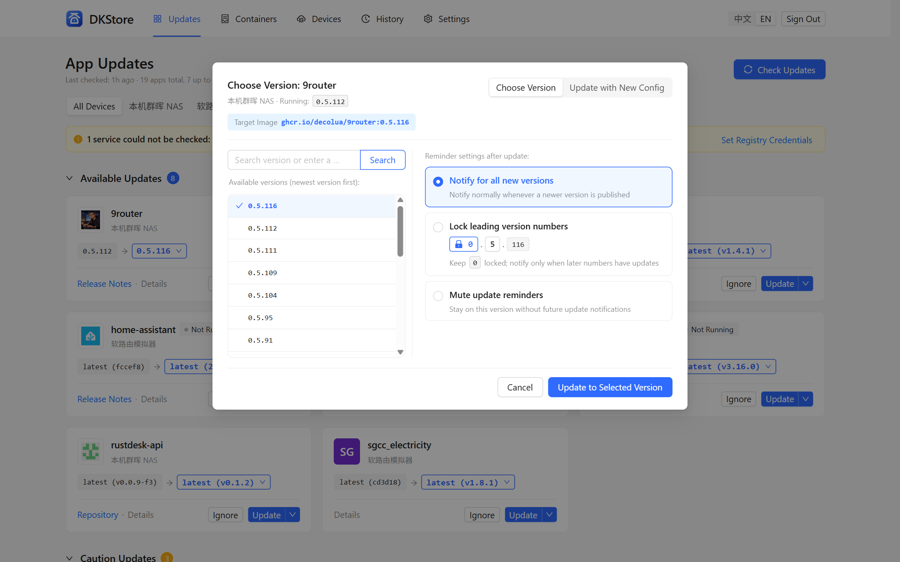
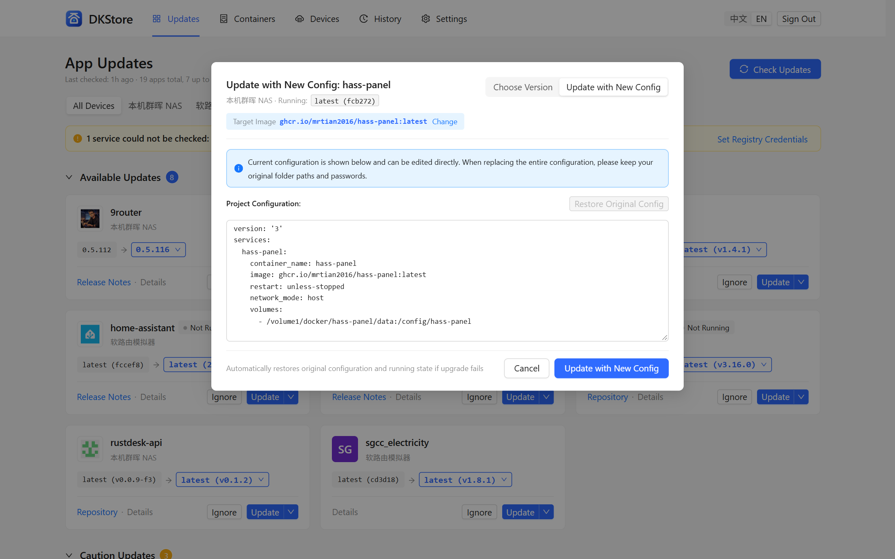
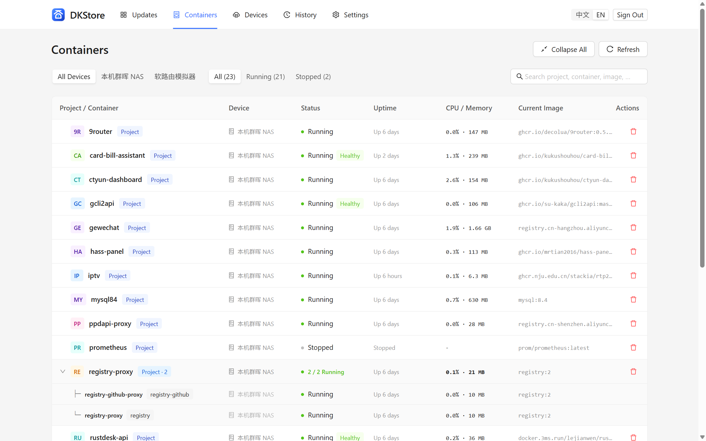
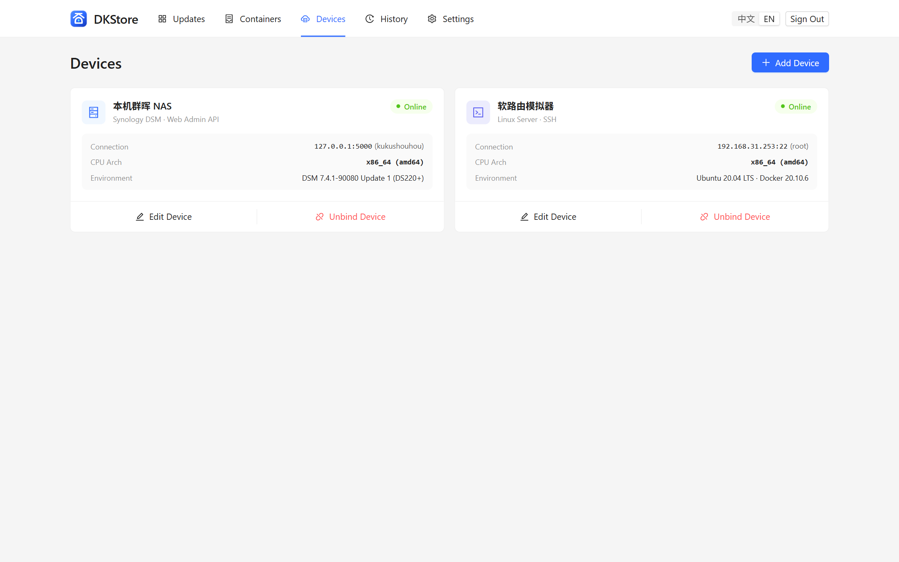
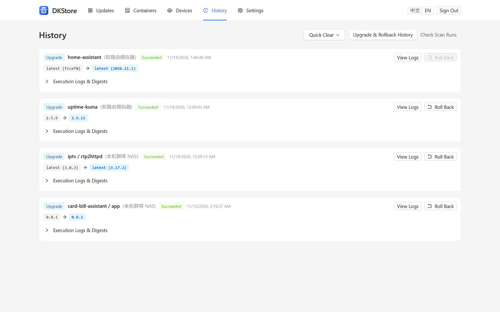

# DKStore — Home Docker App Update Center

<p>
  <strong>English</strong> · <a href="./README_zh-CN.md">简体中文</a> · <a href="./CHANGELOG.md">Changelog</a> · <a href="https://github.com/kukushouhou/DKStore/releases">Releases</a>
</p>

<p>
  <a href="https://github.com/kukushouhou/DKStore/releases"></a>
  
  
  
  
</p>

**DKStore** is an app-store-like Docker update center crafted for home NAS devices, OpenWrt / iStoreOS routers, and personal Linux servers. Install it once on any device in your home network to check updates, safely upgrade individual services, edit configurations in place, and roll back across all your Docker hosts — coexisting seamlessly with native managers like Synology Container Manager and fnOS App Center.

---

## Key Features

- **App-Store Style Update Experience**
  - Resolves real version numbers behind floating tags like `:latest` (e.g., `latest (v1.4.1)`) so you always know what version is running and what is available.
  - Automatically separates **Available Updates** from **Caution Updates** (major version jumps and stateful components such as MySQL, PostgreSQL, Redis, and message queues), with direct links to upstream release notes.
  - Flexible reminder rules: **lock leading version segments** (e.g., stay on `0.5.x` or `v1.x`), **skip a single release**, or **mute reminders**.
- **Install Once, Manage Every Device (No Client Agents Needed)**
  - Connects directly via local `docker.sock`, **SSH-free Synology DSM WebAPI** (supporting 2FA OTP and persistent device tokens), or **standard SSH** (password, PEM key, one-click keypair generation, and `sudo` elevation).
  - Automatically discovers Synology Container Manager projects, Docker Compose stacks, and standalone containers while marking system-managed package containers as read-only so OS packages are never touched.
- **Safe Single-Service Upgrades, In-Place Config Editing & Live Logs**
  - **Zero collateral restarts**: Upgrading a service inside a multi-container Compose or DSM project updates only the target service (`--no-deps`), preserving YAML comments/indentation, custom registry mirrors, and sibling database uptime.
  - **Update with New Config**: Modify Compose YAML or standalone container environment variables and ports directly in the browser when upstream release notes require new settings — complete with folder-path/password overwrite warnings, one-click original config restore, and automatic rollback if startup fails.
  - **Real-time layer progress & `xterm` logs**: Stream per-layer download progress and live execution logs right in the web UI.
- **Verified One-Click Rollbacks**
  - Stores before/after versions, image digests, and full logs for every upgrade. Verifies image tag/digest availability before executing a safe one-click rollback.
- **Container Resource Tree, Cleanup & Push Notifications**
  - Hierarchical project/container monitor showing live CPU & memory usage, health status, uptime, device, and image, with one-click container or whole-project removal (optional image & directory cleanup).
  - Scheduled background checks, inline private registry & Docker Hub credential setup, full **English / Simplified Chinese** UI, and push alerts via **Telegram, Bark, WeCom, ntfy, and Webhooks**.

---

## Screenshots

### 1. App Updates Center (Floating Tag Resolution & Risk Grouping)


### 2. Version Picker & Version Prefix Locking


### 3. In-Place Configuration Update (with Overwrite Protection)


### 4. Hierarchical Container Resource Monitor


### 5. Multi-Device Management


### 6. Upgrade History, Execution Logs & One-Click Rollback


---

## Quick Installation

Download ready-to-install packages from [**GitHub Releases**](https://github.com/kukushouhou/DKStore/releases), or deploy via Docker:

### 1. Synology DSM 7.0+ Native Package (`.spk`)
1. Download `dkstore-x86_64-<version>-0001.spk` (Intel / AMD) or `dkstore-aarch64-<version>-0001.spk` (ARM64).
2. Open DSM **Package Center** → **Manual Install** (top right) and upload the `.spk` file.
3. Launch **DKStore** directly from the DSM Main Menu with automatic admin session sign-in (or visit `http://<NAS-IP>:8090`), and follow the quick wizard to connect local containers without SSH.

### 2. fnOS Native App (`.fpk`)
1. Download `dkstore-fnos-x86-<version>.fpk` (x86_64) or `dkstore-fnos-arm-<version>.fpk` (ARM64).
2. Open fnOS **App Center** → **Manual Install** (bottom left), upload the `.fpk`, and open DKStore from your desktop.

### 3. OpenWrt / iStoreOS LuCI Plugin (`.run` / `.ipk` / `.apk`)
- **iStoreOS One-Click Installer (Recommended)**: Download `dkstore-openwrt-x86_64-<version>.run` or `dkstore-openwrt-aarch64-<version>.run` and upload it in **iStore → Manual Install**.
- **Standard OpenWrt**: Install `luci-app-dkstore_<version>-1_<arch>.ipk` (`opkg`, OpenWrt 24.10 and earlier) or `luci-app-dkstore-<version>-r1-<arch>.apk` (OpenWrt `apk`), then open **Services → DKStore** in LuCI (default port `:8090`).

### 4. Docker Compose
Save as `docker-compose.yml` and run `docker compose up -d`, then visit `http://<HOST-IP>:8780`:

```yaml
services:
  dkstore:
    image: ghcr.io/kukushouhou/dkstore:latest
    container_name: dkstore
    restart: unless-stopped
    ports:
      - "8780:8780"
    volumes:
      - ./data:/data
      # Mount docker.sock to discover and update containers on the local host
      - /var/run/docker.sock:/var/run/docker.sock
      # Optional: mount your Compose root at the identical host path for in-place YAML editing, e.g.:
      # - /volume1/docker:/volume1/docker
    labels:
      dkstore.self: "true"
    environment:
      - TZ=Asia/Shanghai
```

### 5. Standalone Binary (Linux `systemd` / Windows)
- **Linux**: Extract `dkstore-linux-<amd64|arm64|armv7>-<version>.tar.gz`, place `dkstore` in `/usr/local/bin/`, copy `dkstore.service` to `/etc/systemd/system/`, and run `systemctl enable --now dkstore` (default port `:8090`).
- **Windows**: Extract `dkstore-windows-amd64-<version>.zip` and run `dkstore.exe` to manage all NAS and router devices across your LAN from your PC.

---

## Development & Building from Source

Requires Go `1.24+` and Node.js `20+` (the production web bundle in `web/dist/app` is embedded into the Go binary at compile time).

```bash
# 1. Build embedded web frontend
cd web && npm install && npm run build && cd ..

# 2. Start backend server (http://localhost:8090)
go run ./cmd/dkstore --listen :8090 --data ./data

# 3. Run static checks & unit tests
go vet ./... && go test ./...

# 4. Build all multi-platform release packages into dist/
go run ./tools/build_release.go -version v0.2.0
```

