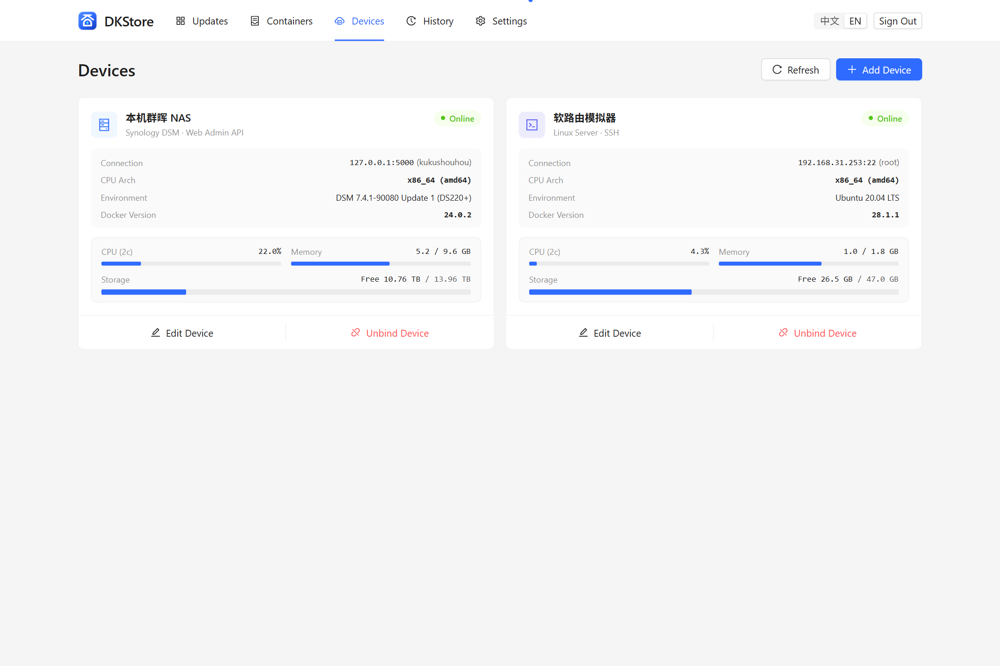
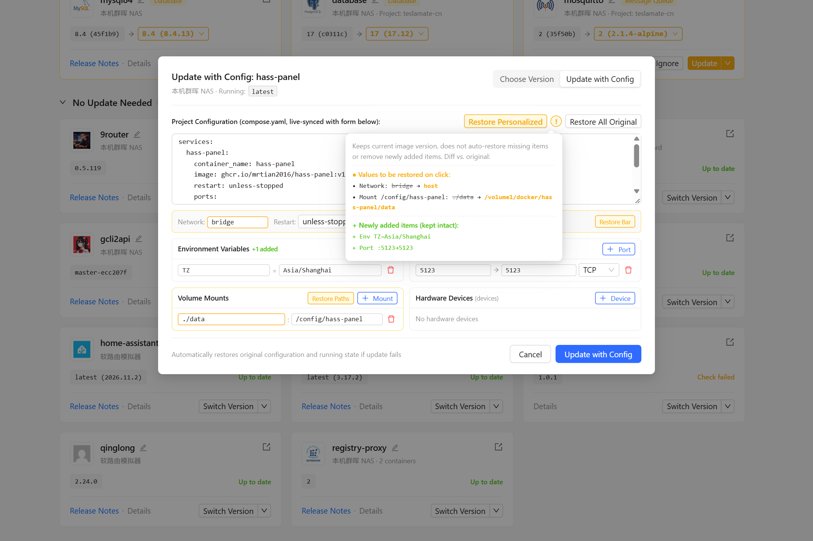
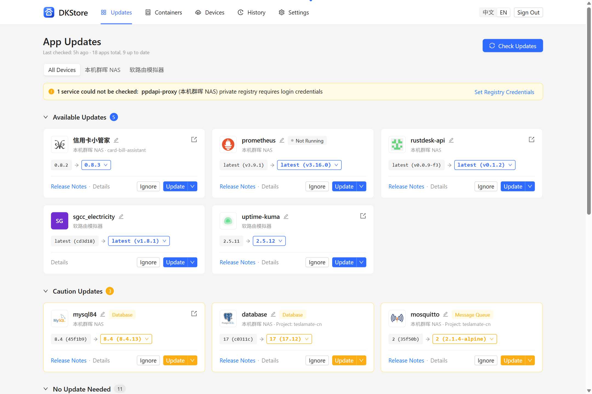
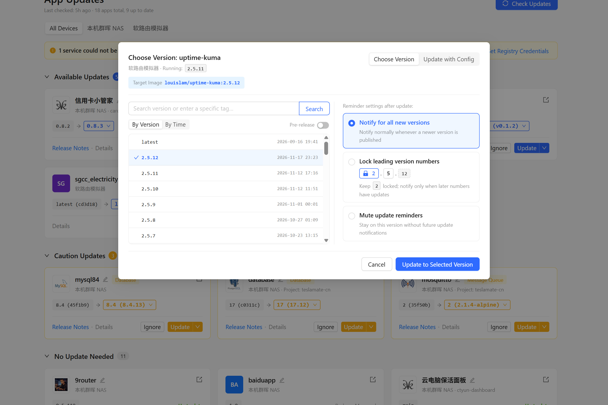
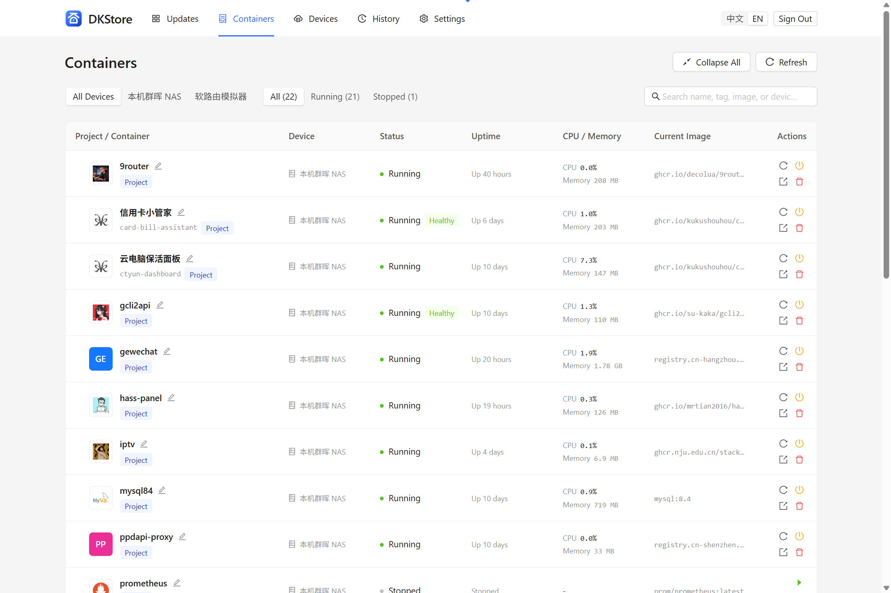
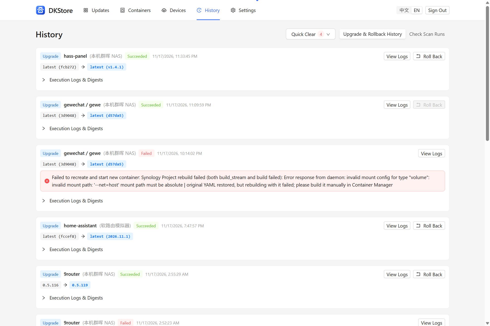
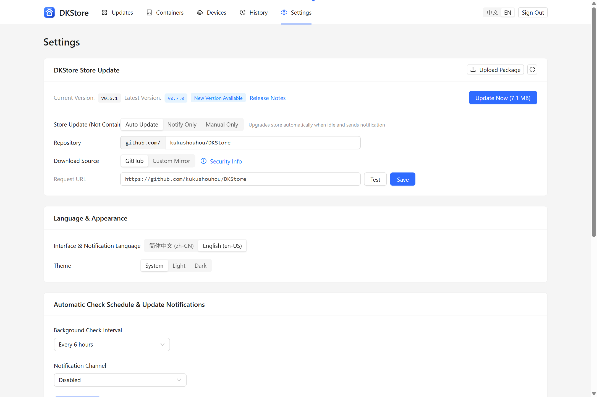

# DKStore — Intuitive, Hassle-Free Docker App Updater

<p>
  <strong>English</strong> · <a href="./README_zh-CN.md">简体中文</a> · <a href="./CHANGELOG.md">Changelog</a> · <a href="https://github.com/kukushouhou/DKStore/releases">Releases</a>
</p>

<p>
  <a href="https://github.com/kukushouhou/DKStore/releases"></a>
  
  
  
  
</p>

**DKStore** is a Docker app updater that **coexists seamlessly with native NAS Docker managers** (such as Synology Container Manager and fnOS Docker), with native installer packages for Synology DSM, fnOS, and iStoreOS / OpenWrt. Check real version numbers behind `latest`, upgrade or roll back existing containers in place without migrating stacks, and **restore your own paths, ports, and passwords in one click** when pasting new upstream configs.

---

## Key Highlights

- **Native Platform Packages & Seamless NAS Manager Coexistence**  
  Ships native installers for Synology DSM (`.spk`), fnOS (`.fpk`), iStoreOS (`.run`), and OpenWrt (`.ipk`/`.apk`) alongside Docker, Linux, and Windows builds — install from your system center and launch directly from the desktop without a second login. **No stack migration needed**: containers created in Synology Container Manager, fnOS Docker, or CLI upgrade in place while remaining fully managed in your native UI (single-service upgrades never restart sibling databases, and system package containers stay read-only), with **SSH-free Synology access** and multi-host SSH management built in.
  <p><a href="./assets/screenshots/hosts-en.png"></a></p>

- **Paste New Configs & Click "Restore Personalized" in One Step**  
  No more line-by-line copying when upstream releases change `compose.yaml` or `docker run` templates: the top config and bottom visual form stay in live two-way sync, and clicking **"Restore Personalized"** brings back your custom paths, ports, and passwords while keeping the new image version and newly added options. Missing original `compose.yaml` files are reconstructed automatically from running containers with a visual folder picker.
  <p><a href="./assets/screenshots/config-update-en.png"></a></p>

- **See Real Versions, Pick Tags & Lock Version Prefixes**  
  Looks up the real version behind `latest` (e.g., `latest (v1.4.1)`), separates routine updates from **Caution Updates** (major jumps and databases) with direct links to release notes, and offers a **Pre-release** toggle, **By Version / By Time** sorting, and **version prefix locking** (e.g., stay on `2.x`).
  <p>
    <a href="./assets/screenshots/updates-en.png"></a>
    <a href="./assets/screenshots/version-picker-en.png"></a>
  </p>

- **One-Click Web Access, Start/Stop Controls & Custom Labels**  
  Click an app icon to open its web UI directly; set custom display names, external URLs, notes, and filterable tags, and start, stop, or restart containers from Home cards or the Containers list (updating a stopped container lets you choose **Update Only** or **Update & Start**).
  <p><a href="./assets/screenshots/containers-en.png"></a></p>

- **Clear Error Reasons, Auto-Resume & One-Click Rollback**  
  Resumes interrupted image downloads automatically; translates daemon errors into clear reasons (timeouts, full disk, port conflicts) with a one-click **Retry** button and automatic config restoration on startup failure; saves version history and logs for instant **Roll Back**.
  <p><a href="./assets/screenshots/history-en.png"></a></p>

- **Push Notifications & DKStore Self-Update**  
  Supports scheduled checks and push alerts via **Telegram, Bark, WeCom, ntfy, and Webhooks**; DKStore itself supports Auto Update, Notify Only, or one-click online / offline package upgrades across all platforms with all data preserved.
  <p><a href="./assets/screenshots/settings-en.png"></a></p>

---

## Quick Installation

Download ready-to-install packages from [**GitHub Releases**](https://github.com/kukushouhou/DKStore/releases/latest), or deploy via Docker.

<sub><strong>Package Selection Guide</strong> (check system info on the left if unsure; mismatched packages are safely rejected):</sub>

<table>
  <thead>
    <tr>
      <th align="left"><sub>Platform (Where to Check)</sub></th>
      <th align="left"><sub>CPU / Architecture</sub></th>
      <th align="left"><sub>Package Filename</sub></th>
    </tr>
  </thead>
  <tbody>
    <tr><td rowspan="2"><sub><strong>fnOS</strong><br>Settings → Device Info</sub></td><td><sub><strong>ARM 64-bit</strong> (ARM NAS, RK3588/3568, OEC / ARM boxes)</sub></td><td><sub><code>dkstore-fnos-arm-&lt;version&gt;.fpk</code></sub></td></tr>
    <tr><td><sub><strong>x86 64-bit</strong> (Intel / AMD mini PCs, DIY PCs)</sub></td><td><sub><code>dkstore-fnos-x86-&lt;version&gt;.fpk</code></sub></td></tr>
    <tr><td rowspan="2"><sub><strong>Synology DSM 7.0+</strong><br>Control Panel → Info Center</sub></td><td><sub><strong>ARM 64-bit</strong> (DS223 / DS124 / j-series Realtek models)</sub></td><td><sub><code>dkstore-aarch64-&lt;version&gt;-0001.spk</code></sub></td></tr>
    <tr><td><sub><strong>x86 64-bit</strong> (DS220+ / DS423+ / DS920+ Intel/AMD)</sub></td><td><sub><code>dkstore-x86_64-&lt;version&gt;-0001.spk</code></sub></td></tr>
    <tr><td rowspan="3"><sub><strong>iStoreOS / OpenWrt</strong><br>Status → Overview</sub></td><td><sub><strong>ARM 64-bit (aarch64)</strong> (R2S / R4S / R5S / N1 / 64-bit ARM routers)</sub></td><td><sub>iStoreOS: <code>dkstore-openwrt-aarch64-&lt;version&gt;.run</code> · OpenWrt: <code>..._aarch64.ipk</code> / <code>.apk</code></sub></td></tr>
    <tr><td><sub><strong>x86 64-bit (x86_64)</strong> (N100 / J4125 routers, VMs)</sub></td><td><sub>iStoreOS: <code>dkstore-openwrt-x86_64-&lt;version&gt;.run</code> · OpenWrt: <code>..._x86_64.ipk</code> / <code>.apk</code></sub></td></tr>
    <tr><td><sub><strong>ARM 32-bit (arm)</strong> (legacy 32-bit ARM routers)</sub></td><td><sub>OpenWrt: <code>luci-app-dkstore_&lt;version&gt;-1_arm.ipk</code></sub></td></tr>
    <tr><td rowspan="3"><sub><strong>Other NAS / PC</strong><br>Docker / Standalone</sub></td><td><sub><strong>Auto-Match CPU (Docker)</strong> (UGREEN / ZSpace / QNAP / Unraid / Linux)</sub></td><td><sub><code>ghcr.io/kukushouhou/dkstore:latest</code></sub></td></tr>
    <tr><td><sub><strong>Linux Standalone Binary</strong> (check via <code>uname -m</code>)</sub></td><td><sub><code>dkstore-linux-&lt;arm64|amd64|armv7&gt;-&lt;version&gt;.tar.gz</code></sub></td></tr>
    <tr><td><sub><strong>Windows 64-bit PC</strong> (Win 10 / 11 extract & run)</sub></td><td><sub><code>dkstore-windows-amd64-&lt;version&gt;.zip</code></sub></td></tr>
  </tbody>
</table>

### 1. fnOS App Package (`.fpk`)
1. Download `dkstore-fnos-arm-<version>.fpk` (ARM64) or `dkstore-fnos-x86-<version>.fpk` (x86_64).
2. Open fnOS **App Center** → **Manual Install** (bottom left), upload the `.fpk`, and launch DKStore from your desktop.

### 2. Synology DSM 7.0+ Package (`.spk`)
1. Download `dkstore-aarch64-<version>-0001.spk` (ARM64) or `dkstore-x86_64-<version>-0001.spk` (Intel / AMD).
2. Open DSM **Package Center** → **Manual Install** (top right) and upload the `.spk` file.
3. Launch **DKStore** directly from the DSM Main Menu with automatic admin session sign-in (or visit `http://<NAS-IP>:8090`), and follow the quick wizard to connect local containers without SSH.

### 3. OpenWrt / iStoreOS LuCI Plugin (`.run` / `.ipk` / `.apk`)
- **iStoreOS One-Click Installer**: Download `dkstore-openwrt-<aarch64|x86_64>-<version>.run` and upload it in **iStore → Manual Install**.
- **Standard OpenWrt**: Install `luci-app-dkstore_<version>-1_<arch>.ipk` (`opkg`, OpenWrt 24.10 and earlier) or `luci-app-dkstore-<version>-r1-<arch>.apk` (OpenWrt `apk`), then open **Services → DKStore** in LuCI (default port `:8090`).

### 4. Docker Compose
Save as `docker-compose.yml` and run `docker compose up -d`, then visit `http://<HOST-IP>:8780`:

```yaml
services:
  dkstore:
    image: ghcr.io/kukushouhou/dkstore:latest
    container_name: dkstore
    restart: unless-stopped
    ports:
      - "8780:8780"
    volumes:
      - ./data:/data
      # Mount docker.sock to discover and update containers on the local host
      - /var/run/docker.sock:/var/run/docker.sock
      # Optional: mount your Compose root at the identical host path for in-place YAML editing, e.g.:
      # - /volume1/docker:/volume1/docker
    labels:
      dkstore.self: "true"
    environment:
      - TZ=Asia/Shanghai
```

### 5. Standalone Binary (Linux `systemd` / Windows)
- **Linux**: Extract `dkstore-linux-<amd64|arm64|armv7>-<version>.tar.gz`, place `dkstore` in `/usr/local/bin/`, copy `dkstore.service` to `/etc/systemd/system/`, and run `systemctl enable --now dkstore` (default port `:8090`).
- **Windows**: Extract `dkstore-windows-amd64-<version>.zip` and run `dkstore.exe` to manage all NAS and router devices across your LAN from your PC.

---

## Development & Building from Source

Requires Go `1.24+` and Node.js `20+` (the production web bundle in `web/dist/app` is embedded into the Go binary at compile time).

```bash
# 1. Build embedded web frontend
cd web && npm install && npm run build && cd ..

# 2. Start backend server (http://localhost:8090)
go run ./cmd/dkstore --listen :8090 --data ./data

# 3. Run static checks & unit tests
go vet ./... && go test ./...

# 4. Build all multi-platform release packages into dist/
go run ./tools/build_release.go -version v0.7.0
```

