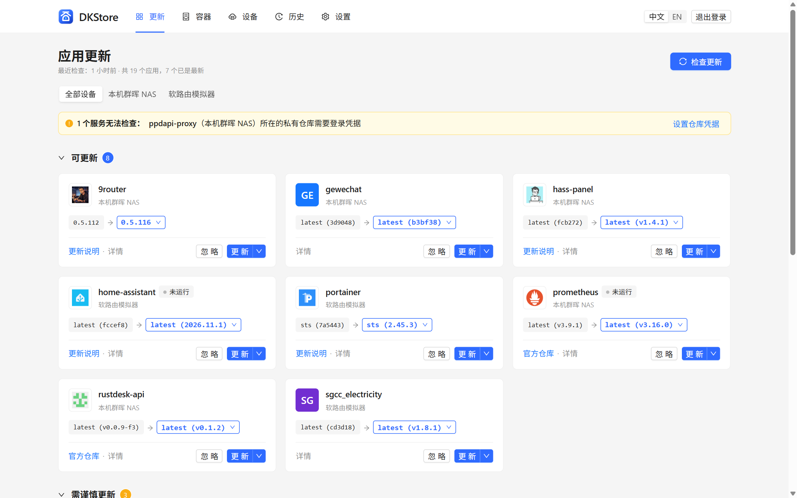
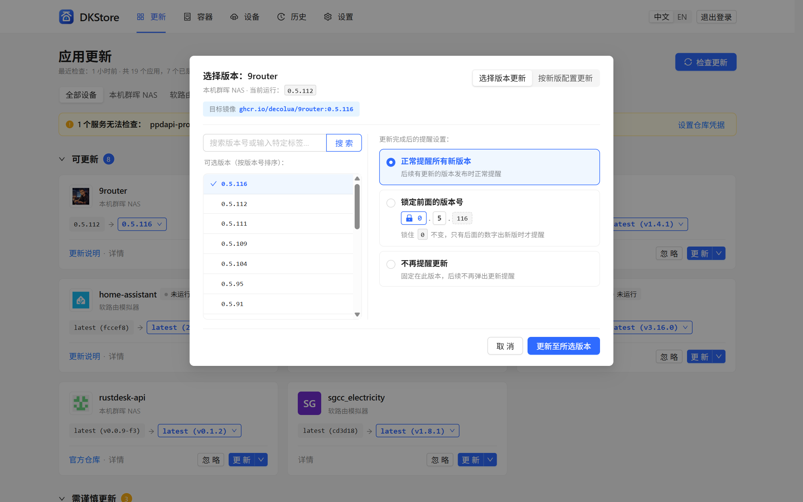
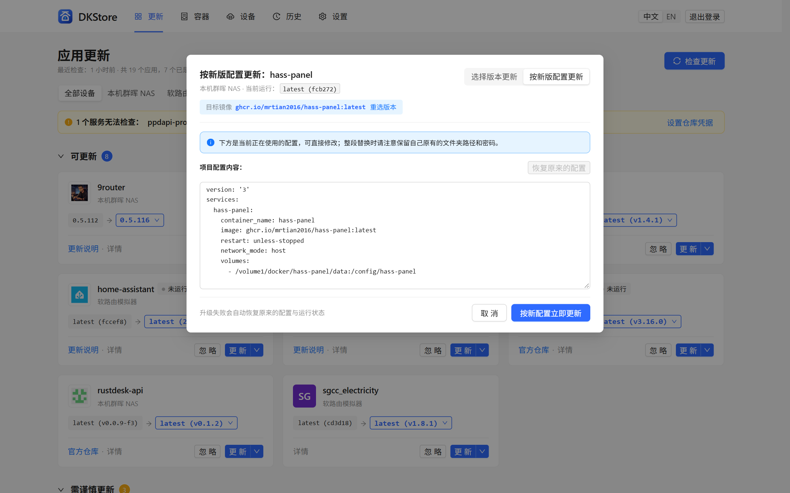
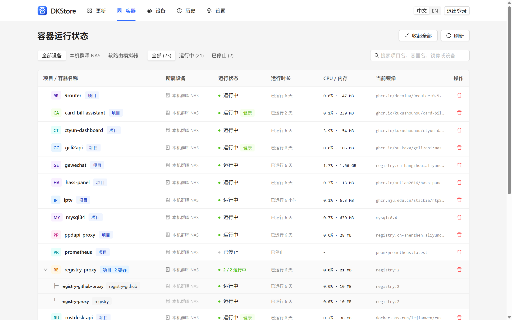
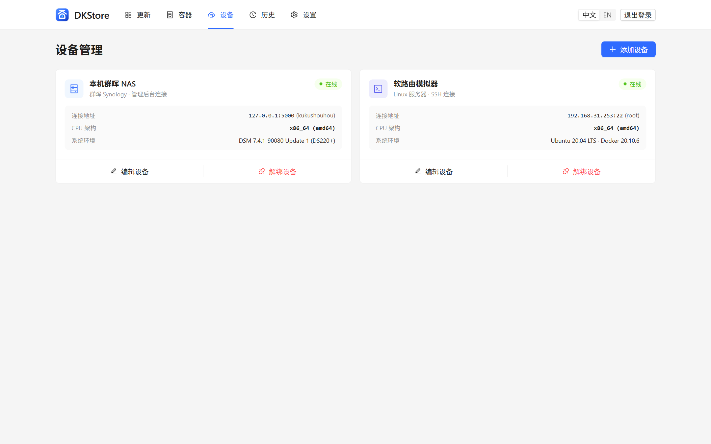
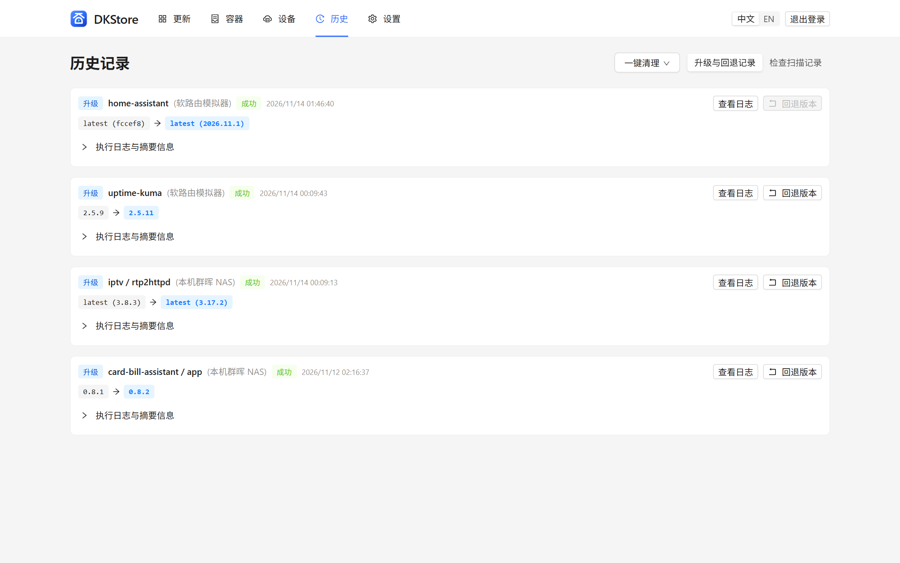

# DKStore — 家庭 Docker 应用更新中心

<p>
  <a href="./README.md">English</a> · <strong>简体中文</strong> · <a href="./CHANGELOG.md">更新日志</a> · <a href="https://github.com/kukushouhou/DKStore/releases">下载安装包</a>
</p>

<p>
  <a href="https://github.com/kukushouhou/DKStore/releases"></a>
  
  
  
  
</p>

**DKStore** 是专为家庭 NAS、软路由与个人服务器打造的跨平台 Docker 应用更新中心。只需在家中任意一台设备安装一次，即可像手机应用商店一样统一检查、一键安全升级、在线调整配置并在必要时一键回退家里所有设备上的 Docker 应用，同时与群晖 Container Manager、飞牛应用中心等系统原生管理器无感并存。

---

## 功能亮点

- **应用商店式更新体验，告别盲目升级**
  - 自动反查 `:latest` 等浮动标签背后的真实版本号（如 `latest (v1.4.1)`），直观对比当前运行版本与最新可用版本。
  - 智能将待更新应用划分为 **「可更新」** 与 **「需谨慎更新」**（自动识别跨大版本升级、MySQL/PostgreSQL/Redis/MQ 等数据库与中间件组件），并附带官方更新说明与仓库直达链接。
  - 灵活的提醒范围控制：支持 **锁定大版本前缀**（例如锁住 `0.5.x` 或 `v1.x` 不跨大版本提醒）、**仅跳过当前版本** 或 **不再提醒**。
- **一处安装，统管全家设备（被管设备免装客户端）**
  - 支持接入本机 Docker、**群晖 DSM WebAPI 免 SSH 连接**（支持两步验证 OTP 与设备信任令牌持久化）以及 **SSH 远程连接**（支持密码、PEM 私钥、一键生成密钥对及 `sudo` 提权），统一管理多台群晖 NAS、飞牛 fnOS、OpenWrt / iStoreOS 软路由与 Linux 主机。
  - 自动识别群晖 Container Manager 原生项目、标准 Docker Compose 项目与独立容器；对系统套件托管容器自动设为只读保护，防止误操作破坏系统套件。
- **单容器安全升级、在线改配置与流式日志**
  - **不连带重启数据库**：升级多容器项目时仅替换目标容器镜像并独立重建，绝不误重启同项目下的数据库或其他关联服务，同时完整保留原 `docker-compose.yml` 注释与缩进，并自动保留原有的镜像加速源前缀。
  - **网页端直接按新版配置更新**：当官方新版要求增改环境变量、端口或 YAML 配置时，可直接在更新弹窗内修改当前配置（内置文件夹路径与密码防误覆盖检测、一键恢复原配置，升级失败自动回滚原配置与运行状态）。
  - **实时进度与终端日志**：实时展示镜像分层下载进度条与只读终端执行日志，多任务队列一目了然。
- **更新历史记录与安全回退**
  - 完整留存每次升级与回退前后的版本号、镜像摘要（Digest）及终端日志；回退前自动核验目标版本镜像可用性，确认安全后一键回退到升级前版本。
- **树状容器监控、残留清理与定时推送**
  - 树状分组展示各设备的项目与容器运行状态、运行时长、实时 CPU / 内存占用，支持一键移除容器或整个项目（可选一并清理镜像与项目目录）。
  - 内置定时自动检查、Docker Hub / 私有仓库凭据原位配置，支持通过 **Telegram、Bark、企业微信、ntfy、Webhook** 推送新版本通知，全界面支持**中英双语**实时切换。

---

## 界面预览

### 1. 应用更新中心（真实版本号反查与风险分级）


### 2. 指定版本切换与版本号前缀锁定


### 3. 按新版配置在线修改更新（防覆盖保护与失败自动还原）


### 4. 容器运行状态树状监控与清理


### 5. 多设备统一接入与管理


### 6. 升级历史记录、执行日志与一键回退


---

## 快速安装

前往 [**GitHub Releases**](https://github.com/kukushouhou/DKStore/releases/latest) 下载对应平台的安装包，或直接使用 Docker 部署。

<sub><strong>安装包选型对照</strong>（不确定芯片可按左侧路径在设备后台查看；若选错包系统会提示不匹配拒绝安装，换另一行即可）：</sub>

<table>
  <thead>
    <tr>
      <th align="left"><sub>设备系统（后台查看位置）</sub></th>
      <th align="left"><sub>CPU / 架构类型</sub></th>
      <th align="left"><sub>对应安装包文件名</sub></th>
    </tr>
  </thead>
  <tbody>
    <tr><td rowspan="2"><sub><strong>飞牛 fnOS</strong><br>设置 → 设备信息</sub></td><td><sub><strong>ARM 64位</strong>（ARM 成品 NAS、RK3588/3568、OEC 等盒子）</sub></td><td><sub><code>dkstore-fnos-arm-&lt;版本&gt;.fpk</code></sub></td></tr>
    <tr><td><sub><strong>x86 64位</strong>（Intel / AMD 小主机、电脑组装机）</sub></td><td><sub><code>dkstore-fnos-x86-&lt;版本&gt;.fpk</code></sub></td></tr>
    <tr><td rowspan="2"><sub><strong>群晖 DSM 7.0+</strong><br>控制面板 → 信息中心</sub></td><td><sub><strong>ARM 64位</strong>（DS223 / DS124 / j 系列等 Realtek 机型）</sub></td><td><sub><code>dkstore-aarch64-&lt;版本&gt;-0001.spk</code></sub></td></tr>
    <tr><td><sub><strong>x86 64位</strong>（DS220+ / DS423+ / DS920+ 等 Intel/AMD）</sub></td><td><sub><code>dkstore-x86_64-&lt;版本&gt;-0001.spk</code></sub></td></tr>
    <tr><td rowspan="3"><sub><strong>iStoreOS / OpenWrt</strong><br>状态 → 概览</sub></td><td><sub><strong>ARM 64位 (aarch64)</strong>（R2S / R4S / R5S / N1 等 64位路由盒子）</sub></td><td><sub>iStoreOS: <code>dkstore-openwrt-aarch64-&lt;版本&gt;.run</code> · OpenWrt: <code>..._aarch64.ipk</code> / <code>.apk</code></sub></td></tr>
    <tr><td><sub><strong>x86 64位 (x86_64)</strong>（N100 / J4125 软路由、虚拟机）</sub></td><td><sub>iStoreOS: <code>dkstore-openwrt-x86_64-&lt;版本&gt;.run</code> · OpenWrt: <code>..._x86_64.ipk</code> / <code>.apk</code></sub></td></tr>
    <tr><td><sub><strong>ARM 32位 (arm)</strong>（老款 32 位 ARM 路由器）</sub></td><td><sub>OpenWrt: <code>luci-app-dkstore_&lt;版本&gt;-1_arm.ipk</code></sub></td></tr>
    <tr><td rowspan="3"><sub><strong>其他 NAS / 电脑</strong><br>Docker / 独立运行</sub></td><td><sub><strong>自动匹配芯片（Docker）</strong>（绿联 / 极空间 / 威联通 / Unraid / Linux）</sub></td><td><sub><code>ghcr.io/kukushouhou/dkstore:latest</code></sub></td></tr>
    <tr><td><sub><strong>Linux 命令行二进制</strong>（<code>uname -m</code> 查看架构）</sub></td><td><sub><code>dkstore-linux-&lt;arm64|amd64|armv7&gt;-&lt;版本&gt;.tar.gz</code></sub></td></tr>
    <tr><td><sub><strong>Windows 64位电脑</strong>（Win 10 / 11 解压双击运行）</sub></td><td><sub><code>dkstore-windows-amd64-&lt;版本&gt;.zip</code></sub></td></tr>
  </tbody>
</table>

### 方式一：飞牛 fnOS 应用包（`.fpk`）
1. 按上方表格下载 `dkstore-fnos-arm-<版本>.fpk`（ARM64）或 `dkstore-fnos-x86-<版本>.fpk`（x86_64）。
2. 在飞牛桌面进入 **应用中心**，点击左下角 **手动安装** 并上传 `.fpk` 文件，安装完成后直接点击桌面图标打开。

### 方式二：群晖 Synology DSM 7.0+ 套件（`.spk`）
1. 按上方表格下载 `dkstore-aarch64-<版本>-0001.spk`（ARM64）或 `dkstore-x86_64-<版本>-0001.spk`（Intel / AMD）。
2. 打开群晖 **套件中心** → 点击右上角 **手动安装**，上传 `.spk` 完成安装。
3. 从 DSM 左上角主菜单点击 **DKStore 容器更新中心** 即可免二次密码直接进入（也可通过 `http://<群晖IP>:8090` 独立访问），首次进入向导可一键免 SSH 接入本机群晖容器。

### 方式三：OpenWrt / iStoreOS 软路由插件（`.run` / `.ipk` / `.apk`）
- **iStoreOS 一键安装**：下载对应架构的 `dkstore-openwrt-<aarch64|x86_64>-<版本>.run`，在 **iStore → 手动安装** 上传 `.run` 包即可自动安装后台服务与 LuCI 页面。
- **标准 OpenWrt**：OpenWrt 24.10 及以下下载 `luci-app-dkstore_<版本>-1_<架构>.ipk`（`opkg install`）；采用 `apk` 的新版本下载 `luci-app-dkstore-<版本>-r1-<架构>.apk`。安装后在后台 **服务 → DKStore** 打开（默认监听 `:8090`）。

### 方式四：Docker Compose 部署
创建 `docker-compose.yml` 并执行 `docker compose up -d`，浏览器访问 `http://<设备IP>:8780`：

```yaml
services:
  dkstore:
    image: ghcr.io/kukushouhou/dkstore:latest
    container_name: dkstore
    restart: unless-stopped
    ports:
      - "8780:8780"
    volumes:
      - ./data:/data
      # 接入并更新本机 Docker 容器时挂载 docker.sock
      - /var/run/docker.sock:/var/run/docker.sock
      # 如需直接在容器内在线修改本机 Compose 项目文件，请按宿主原路径挂载项目目录，例如：
      # - /volume1/docker:/volume1/docker
    labels:
      dkstore.self: "true"
    environment:
      - TZ=Asia/Shanghai
```

### 方式五：Linux / Windows 独立二进制运行
- **Linux（`systemd`）**：解压 `dkstore-linux-<amd64|arm64|armv7>-<版本>.tar.gz`，将 `dkstore` 放入 `/usr/local/bin/`，复制包内 `dkstore.service` 至 `/etc/systemd/system/` 后执行 `systemctl enable --now dkstore`（默认端口 `8090`）。
- **Windows**：解压 `dkstore-windows-amd64-<版本>.zip` 运行 `dkstore.exe`，即可在电脑上通过局域网远程统一管理家里的多台 NAS 与软路由。

---

## 本地开发与构建

环境要求：Go `1.24+`、Node.js `20+`（内嵌前端架构，编译后端二进制前需先构建 `web/dist/app`）。

```bash
# 1. 构建前端静态资源
cd web && npm install && npm run build && cd ..

# 2. 本地启动服务（http://localhost:8090）
go run ./cmd/dkstore --listen :8090 --data ./data

# 3. 运行静态检查与单元测试
go vet ./... && go test ./...

# 4. 一键打包全平台发行产物至 dist/
go run ./tools/build_release.go -version v0.2.0
```

