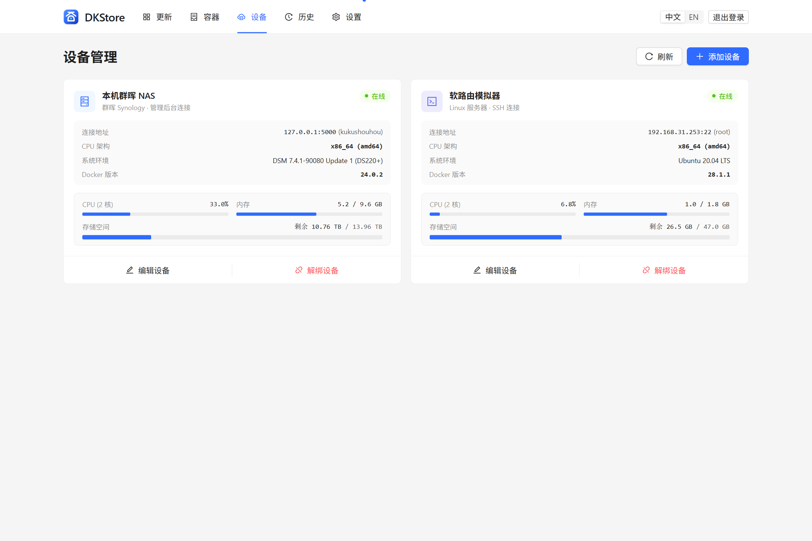
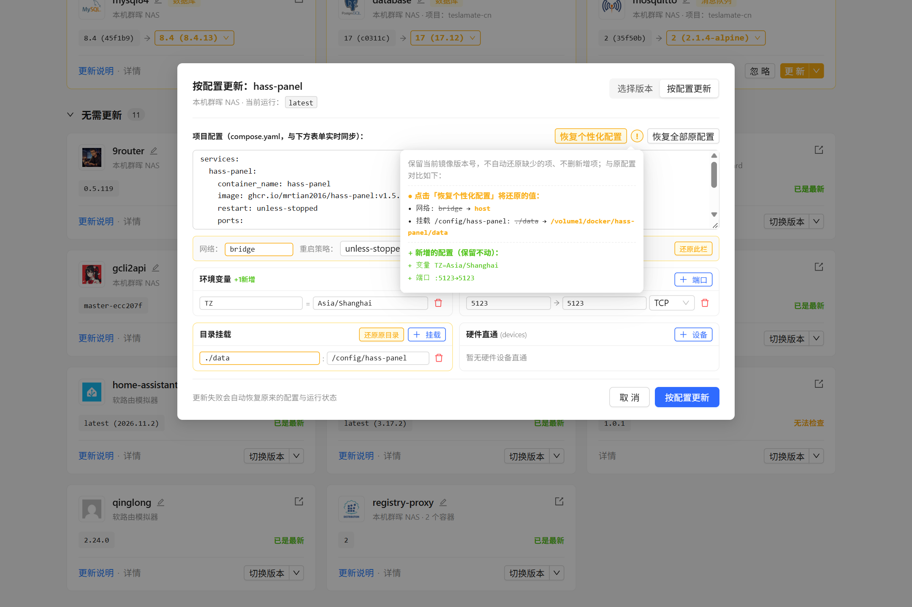
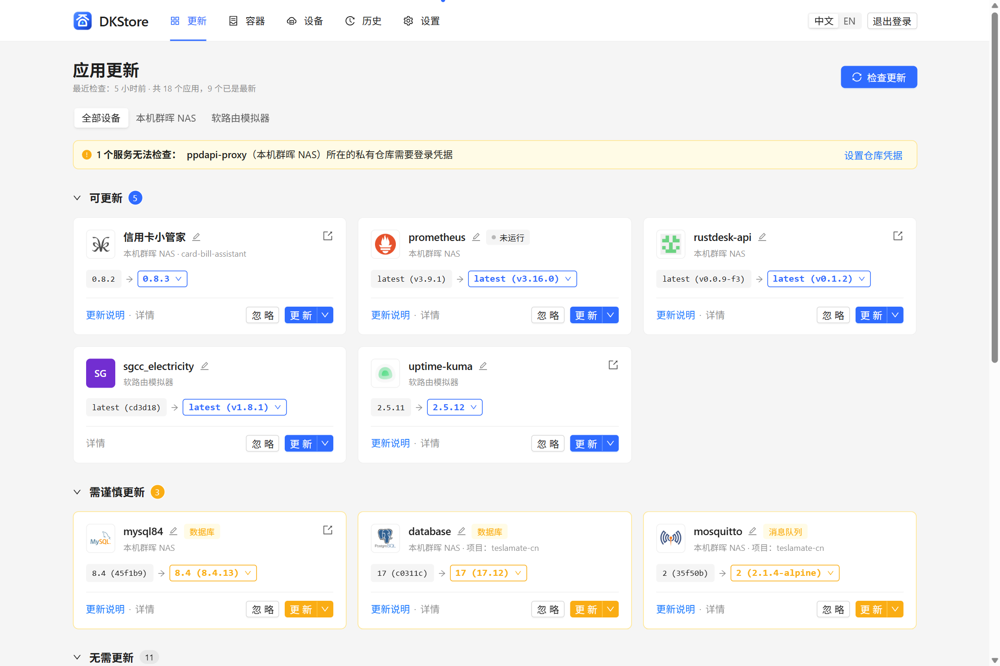
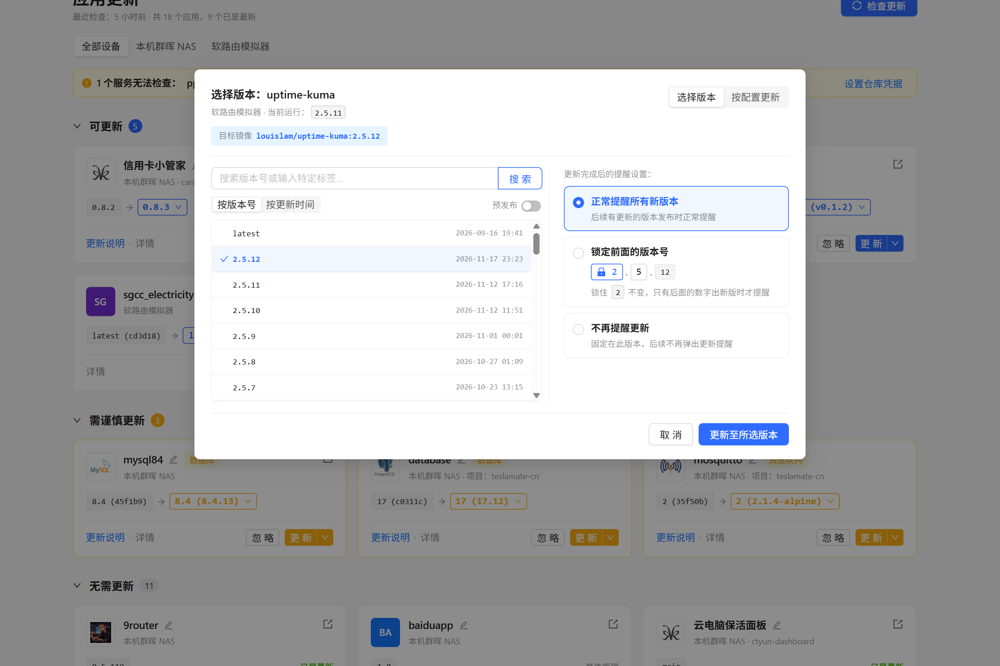
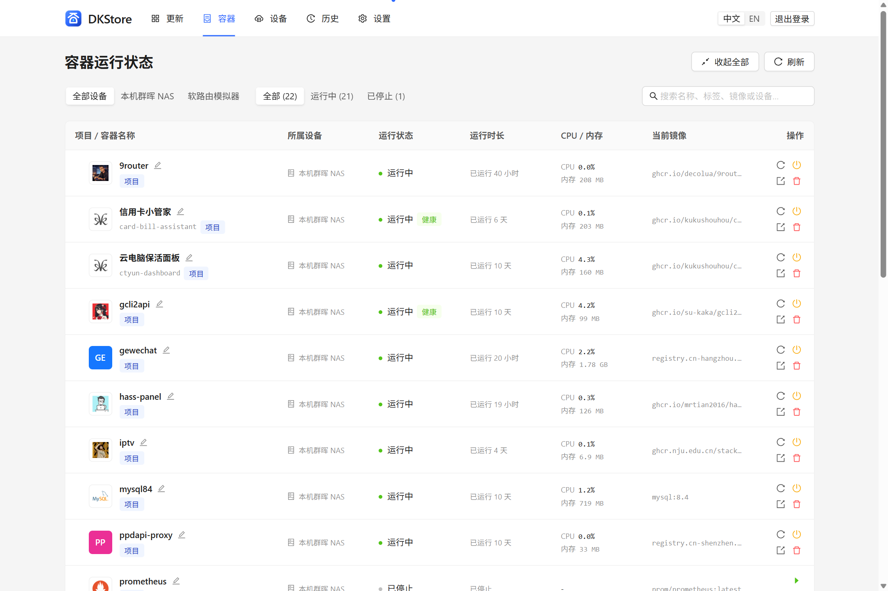
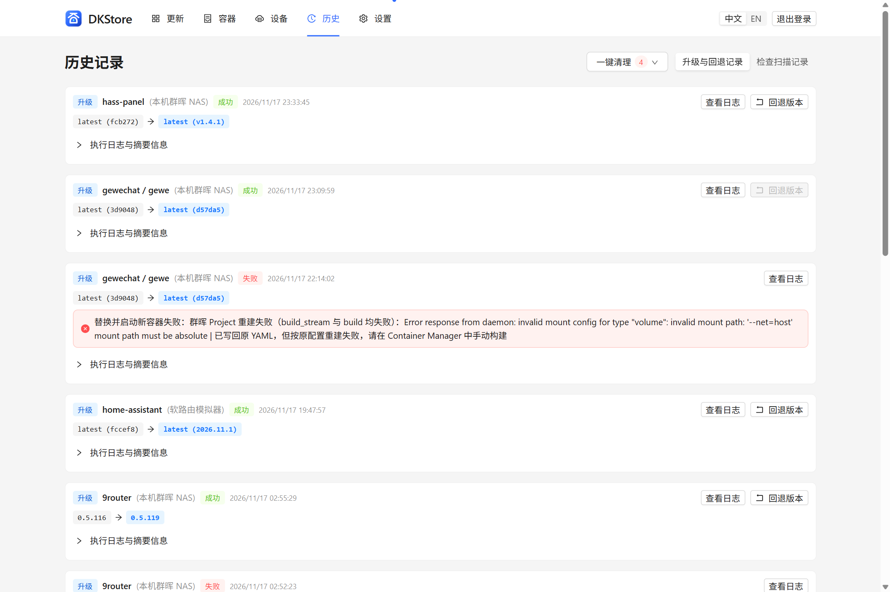
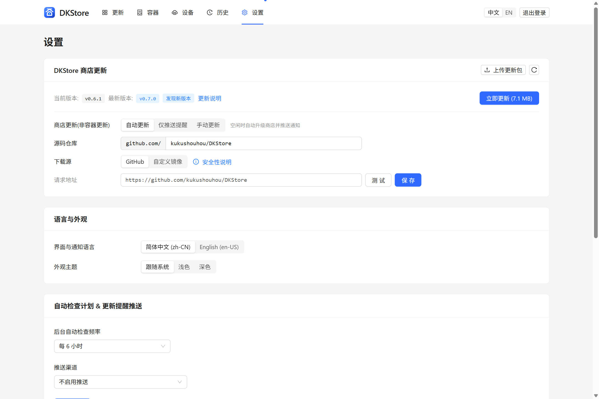

# DKStore — 直观省心的 Docker 应用更新工具

<p>
  <a href="./README.md">English</a> · <strong>简体中文</strong> · <a href="./CHANGELOG.md">更新日志</a> · <a href="https://github.com/kukushouhou/DKStore/releases">下载安装包</a>
</p>

<p>
  <a href="https://github.com/kukushouhou/DKStore/releases"></a>
  
  
  
  
</p>

**DKStore** 是一款可与群晖、飞牛等系统自带 Docker 管理器**无缝共存**的应用更新工具，提供群晖、飞牛、iStoreOS / OpenWrt 等各平台原生安装包。无需迁移原有容器即可看清 `latest` 真实版本、一键升级与回退，换新版配置时还能**一键恢复自己原有的目录、端口和密码**。

---

## 功能亮点

- **各平台原生安装，与 NAS 自带 Docker 管理器无缝共存**  
  提供群晖 `.spk`、飞牛 `.fpk`、iStoreOS `.run`、OpenWrt `.ipk`/`.apk` 原生安装包（及 Docker / Linux / Windows 版），装好后直接从系统桌面免二次密码打开。**无需迁移或重建现有项目**：群晖 Container Manager、飞牛 Docker 等自带管理器创建的容器可直接原地升级，升完在原管理器中依然正常受管（单更某容器时不连带重启同项目数据库，系统套件容器自动只读保护），同时支持**群晖免开 SSH 直连**与多设备 SSH 集中管理。
  <p><a href="./assets/screenshots/hosts-zh.png"></a></p>

- **粘贴新版配置，一键「恢复个性化配置」**  
  整段粘贴官方新版 `compose.yaml` 或 `docker run` 示例时无需逐行手抄旧配置：上方文本与下方表单实时双向同步，点一下 **「恢复个性化配置」** 即可还原被示例值覆盖的个人目录、端口和密码，同时保留新镜像版本与官方新增项；原配置文件缺失时还能从运行容器自动生成并选择保存目录。
  <p><a href="./assets/screenshots/config-update-zh.png"></a></p>

- **看清真实版本号，自由选版与锁定前缀**  
  自动查出 `latest` 背后的实际版本（如 `latest (v1.4.1)`），将常规更新与数据库等 **「需谨慎更新」** 分开展示并直达官方更新说明；选版弹窗支持切换 **「预发布」**、按版本号或更新时间排序，以及 **锁定前面的版本号**（如锁住 `2.x` 不跨大版本提醒）。
  <p>
    <a href="./assets/screenshots/updates-zh.png"></a>
    <a href="./assets/screenshots/version-picker-zh.png"></a>
  </p>

- **网页一键直达、容器启停与备注标签**  
  点击应用图标即可直接打开容器网页后台；支持自定义中文备注名、访问网址与分类标签，在首页或容器列表可直接启动、停止、重启容器（更新未运行容器时可自由选择「仅更新不启动」或「更新并启动」）。
  <p><a href="./assets/screenshots/containers-zh.png"></a></p>

- **清晰报错提示、断流续传与一键回退**  
  镜像下载遇网络波动自动断点续传；升级出错直接转为清晰原因（如网络超时、空间不足、端口占用）并提供一键 **「重试」**，新配置启动失败自动还原；每次升级留存版本与日志，新版不好用随时一键 **「回退版本」**。
  <p><a href="./assets/screenshots/history-zh.png"></a></p>

- **新版本消息推送与 DKStore 自更新**  
  支持定时检查并通过 **企业微信、Bark、Telegram、ntfy、Webhook** 推送更新提醒；DKStore 自身支持自动更新、仅推送提醒或手动在线 / 上传离线包一键升级，全平台保留原有设备配置与历史记录。
  <p><a href="./assets/screenshots/settings-zh.png"></a></p>

---

## 快速安装

前往 [**GitHub Releases**](https://github.com/kukushouhou/DKStore/releases/latest) 下载对应平台的安装包，或直接使用 Docker 部署。

<sub><strong>安装包选型对照</strong>（不确定芯片可按左侧路径在设备后台查看；若选错包系统会提示不匹配拒绝安装，换另一行即可）：</sub>

<table>
  <thead>
    <tr>
      <th align="left"><sub>设备系统（后台查看位置）</sub></th>
      <th align="left"><sub>CPU / 架构类型</sub></th>
      <th align="left"><sub>对应安装包文件名</sub></th>
    </tr>
  </thead>
  <tbody>
    <tr><td rowspan="2"><sub><strong>飞牛 fnOS</strong><br>设置 → 设备信息</sub></td><td><sub><strong>ARM 64位</strong>（ARM 成品 NAS、RK3588/3568、OEC 等盒子）</sub></td><td><sub><code>dkstore-fnos-arm-&lt;版本&gt;.fpk</code></sub></td></tr>
    <tr><td><sub><strong>x86 64位</strong>（Intel / AMD 小主机、电脑组装机）</sub></td><td><sub><code>dkstore-fnos-x86-&lt;版本&gt;.fpk</code></sub></td></tr>
    <tr><td rowspan="2"><sub><strong>群晖 DSM 7.0+</strong><br>控制面板 → 信息中心</sub></td><td><sub><strong>ARM 64位</strong>（DS223 / DS124 / j 系列等 Realtek 机型）</sub></td><td><sub><code>dkstore-aarch64-&lt;版本&gt;-0001.spk</code></sub></td></tr>
    <tr><td><sub><strong>x86 64位</strong>（DS220+ / DS423+ / DS920+ 等 Intel/AMD）</sub></td><td><sub><code>dkstore-x86_64-&lt;版本&gt;-0001.spk</code></sub></td></tr>
    <tr><td rowspan="3"><sub><strong>iStoreOS / OpenWrt</strong><br>状态 → 概览</sub></td><td><sub><strong>ARM 64位 (aarch64)</strong>（R2S / R4S / R5S / N1 等 64位路由盒子）</sub></td><td><sub>iStoreOS: <code>dkstore-openwrt-aarch64-&lt;版本&gt;.run</code> · OpenWrt: <code>..._aarch64.ipk</code> / <code>.apk</code></sub></td></tr>
    <tr><td><sub><strong>x86 64位 (x86_64)</strong>（N100 / J4125 软路由、虚拟机）</sub></td><td><sub>iStoreOS: <code>dkstore-openwrt-x86_64-&lt;版本&gt;.run</code> · OpenWrt: <code>..._x86_64.ipk</code> / <code>.apk</code></sub></td></tr>
    <tr><td><sub><strong>ARM 32位 (arm)</strong>（老款 32 位 ARM 路由器）</sub></td><td><sub>OpenWrt: <code>luci-app-dkstore_&lt;版本&gt;-1_arm.ipk</code></sub></td></tr>
    <tr><td rowspan="3"><sub><strong>其他 NAS / 电脑</strong><br>Docker / 独立运行</sub></td><td><sub><strong>自动匹配芯片（Docker）</strong>（绿联 / 极空间 / 威联通 / Unraid / Linux）</sub></td><td><sub><code>ghcr.io/kukushouhou/dkstore:latest</code></sub></td></tr>
    <tr><td><sub><strong>Linux 命令行二进制</strong>（<code>uname -m</code> 查看架构）</sub></td><td><sub><code>dkstore-linux-&lt;arm64|amd64|armv7&gt;-&lt;版本&gt;.tar.gz</code></sub></td></tr>
    <tr><td><sub><strong>Windows 64位电脑</strong>（Win 10 / 11 解压双击运行）</sub></td><td><sub><code>dkstore-windows-amd64-&lt;版本&gt;.zip</code></sub></td></tr>
  </tbody>
</table>

### 方式一：飞牛 fnOS 应用包（`.fpk`）
1. 按上方表格下载 `dkstore-fnos-arm-<版本>.fpk`（ARM64）或 `dkstore-fnos-x86-<版本>.fpk`（x86_64）。
2. 在飞牛桌面进入 **应用中心**，点击左下角 **手动安装** 并上传 `.fpk` 文件，安装完成后直接点击桌面图标打开。

### 方式二：群晖 Synology DSM 7.0+ 套件（`.spk`）
1. 按上方表格下载 `dkstore-aarch64-<版本>-0001.spk`（ARM64）或 `dkstore-x86_64-<版本>-0001.spk`（Intel / AMD）。
2. 打开群晖 **套件中心** → 点击右上角 **手动安装**，上传 `.spk` 完成安装。
3. 从 DSM 左上角主菜单点击 **DKStore 容器更新中心** 即可免二次密码直接进入（也可通过 `http://<群晖IP>:8090` 独立访问），首次进入向导可一键免 SSH 接入本机群晖容器。

### 方式三：OpenWrt / iStoreOS 软路由插件（`.run` / `.ipk` / `.apk`）
- **iStoreOS 一键安装**：下载对应架构的 `dkstore-openwrt-<aarch64|x86_64>-<版本>.run`，在 **iStore → 手动安装** 上传 `.run` 包即可自动安装后台服务与 LuCI 页面。
- **标准 OpenWrt**：OpenWrt 24.10 及以下下载 `luci-app-dkstore_<版本>-1_<架构>.ipk`（`opkg install`）；采用 `apk` 的新版本下载 `luci-app-dkstore-<版本>-r1-<架构>.apk`。安装后在后台 **服务 → DKStore** 打开（默认监听 `:8090`）。

### 方式四：Docker Compose 部署
创建 `docker-compose.yml` 并执行 `docker compose up -d`，浏览器访问 `http://<设备IP>:8780`：

```yaml
services:
  dkstore:
    image: ghcr.io/kukushouhou/dkstore:latest
    container_name: dkstore
    restart: unless-stopped
    ports:
      - "8780:8780"
    volumes:
      - ./data:/data
      # 接入并更新本机 Docker 容器时挂载 docker.sock
      - /var/run/docker.sock:/var/run/docker.sock
      # 如需直接在容器内在线修改本机 Compose 项目文件，请按宿主原路径挂载项目目录，例如：
      # - /volume1/docker:/volume1/docker
    labels:
      dkstore.self: "true"
    environment:
      - TZ=Asia/Shanghai
```

### 方式五：Linux / Windows 独立二进制运行
- **Linux（`systemd`）**：解压 `dkstore-linux-<amd64|arm64|armv7>-<版本>.tar.gz`，将 `dkstore` 放入 `/usr/local/bin/`，复制包内 `dkstore.service` 至 `/etc/systemd/system/` 后执行 `systemctl enable --now dkstore`（默认端口 `8090`）。
- **Windows**：解压 `dkstore-windows-amd64-<版本>.zip` 运行 `dkstore.exe`，即可在电脑上通过局域网远程统一管理家里的多台 NAS 与软路由。

---

## 本地开发与构建

环境要求：Go `1.24+`、Node.js `20+`（内嵌前端架构，编译后端二进制前需先构建 `web/dist/app`）。

```bash
# 1. 构建前端静态资源
cd web && npm install && npm run build && cd ..

# 2. 本地启动服务（http://localhost:8090）
go run ./cmd/dkstore --listen :8090 --data ./data

# 3. 运行静态检查与单元测试
go vet ./... && go test ./...

# 4. 一键打包全平台发行产物至 dist/
go run ./tools/build_release.go -version v0.7.0
```

